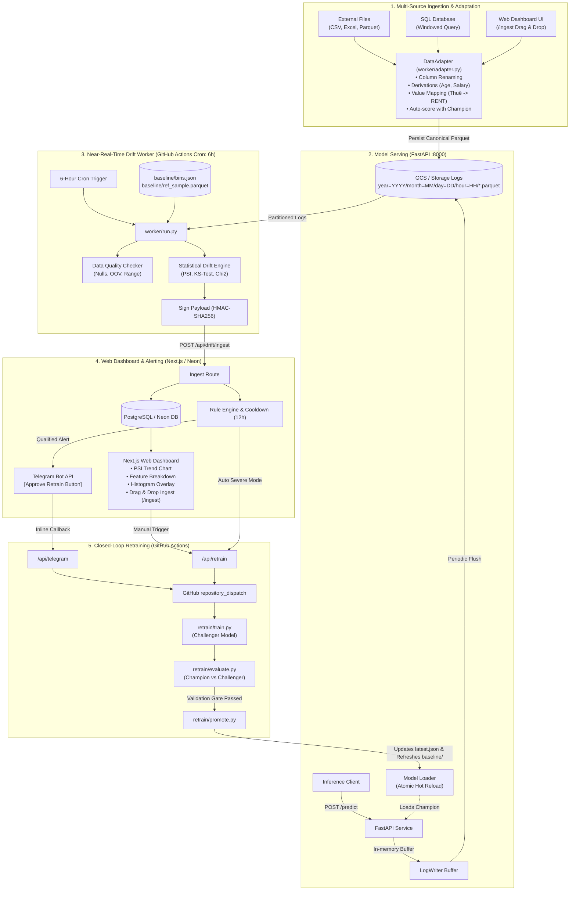
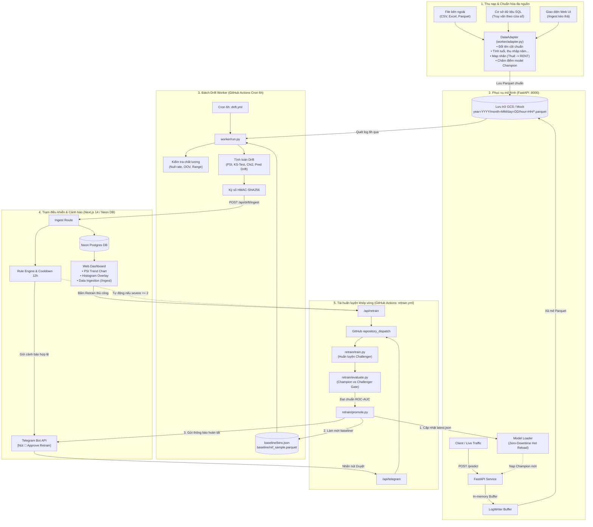

# Near-Real-Time Data Drift Monitoring & Closed-Loop Retraining Platform
<a id="top"></a>

<p align="center">
  <b><a href="#english-version">🇬🇧 English Version</a></b> &nbsp; | &nbsp; <b><a href="#vietnamese-version">🇻🇳 Bản Tiếng Việt</a></b>
  <br>
  <sub><i>(Hoặc xem file độc lập: <a href="README.vn.md">README.vn.md</a>)</i></sub>
</p>

<p align="center">
  <a href="https://github.com/your-org/drift-platform/actions/workflows/ci.yml"></a>
  <a href="https://github.com/your-org/drift-platform/actions/workflows/drift.yml"></a>
  <a href="LICENSE"></a>
</p>

---

<a id="english-version"></a>
## 🇬🇧 English Version

An end-to-end, cost-effective MLOps platform for **near-real-time batch monitoring** of tabular machine learning models, automated data drift detection, Telegram alerting with alert deduplication and cooldowns, and governed closed-loop retraining (Champion vs. Challenger with instant rollback).

---

### Table of Contents
1. [Problem Statement & Objectives](#problem-statement--objectives)
2. [Architecture & Workflow](#architecture--workflow)
3. [Quantifying Drift: Statistical Foundations](#quantifying-drift-statistical-foundations)
4. [Platform Components](#platform-components)
   - [Model Serving (`serving/`)](#1-model-serving-serving)
   - [Batch Drift Worker (`worker/`)](#2-batch-drift-worker-worker)
   - [Automated Retraining (`retrain/`)](#3-automated-retraining-retrain)
   - [Multi-Source Ingestion & Adapter (`worker/adapter.py`)](#4-multi-source-data-ingestion--adapter-layer-workeradapterpy)
   - [Web Dashboard & Control Plane (`web/`)](#5-web-dashboard--control-plane-web)
5. [System Benchmark Evaluation](#system-benchmark-evaluation)
6. [Getting Started & Local Development](#getting-started--local-development)
7. [Repository Structure](#repository-structure)

---

## Problem Statement & Objectives

### The Problem
When machine learning models are deployed to production, production data distributions naturally deviate from the original training distribution over time (**data drift**). This silent degradation degrades inference accuracy and downstream business KPIs without causing traditional software errors or exceptions.

### Core Objectives
1. **Automated Inference Logging**: Buffer predictions asynchronously with zero latency penalty and flush hive-partitioned Parquet files to Google Cloud Storage (GCS) or local emulated storage.
2. **Comprehensive Drift Quantification**: Compute Population Stability Index (PSI), Kolmogorov-Smirnov test (continuous variables), Chi-Square test (categorical variables), and prediction drift on model output probabilities.
3. **Web Dashboard & Visualizations**: High-performance dashboard featuring historical PSI trends, sortable feature status breakdowns, side-by-side **Histogram Overlays**, and a **Drag & Drop Data Ingestion UI** (`/ingest`).
4. **Intelligent Telegram Alerting**: Instant notification dispatched via Telegram bots featuring 12-hour cooldown windows and cryptographic deduplication to eliminate notification fatigue.
5. **Controlled Closed-Loop Retraining**: Automated GitHub Actions workflow trigger (`repository_dispatch`) featuring Champion vs. Challenger offline validation gates and atomic rollback.
6. **Multi-Source Ingestion & Adaptation**: Ingest raw batch data from legacy CRM files, Excel/CSV, database SQL tables, or APIs with automated schema harmonization and Champion model scoring.
7. **System Evaluation**: Rigorous measurement of sensitivity, detection delay, and false alarm rate under stationary conditions, compared against Evidently AI reference implementations.

> [!NOTE]
> **Operational Terminology**: This platform operates in **near-real-time / batch mode** (e.g. running on a scheduled 6-hour cron batch or daily window), not real-time streaming, maximizing cost efficiency on serverless infrastructure (GitHub Actions, GCS, Neon/Postgres, Vercel).

---

## Architecture & Workflow



---

## Quantifying Drift: Statistical Foundations

### 1. Population Stability Index (PSI)
PSI measures the divergence between the baseline reference distribution $Q$ and the current production batch $P$:

$$\text{PSI} = \sum_{i=1}^{k} \big( P_i - Q_i \big) \times \ln\left( \frac{P_i}{Q_i} \right)$$

- **Continuous Features**: Evaluated across 10 quantile bins derived from baseline reference data.
- **Laplace / Epsilon Smoothing**: An $\epsilon = 0.0001$ smoothing term is applied to prevent numerical instability or division by zero:
  $$P_i = \frac{N_{\text{prod}, i} + \epsilon}{\sum N_{\text{prod}} + k \cdot \epsilon}, \quad Q_i = \frac{N_{\text{ref}, i} + \epsilon}{\sum N_{\text{ref}} + k \cdot \epsilon}$$
- **Threshold Interpretations**:
  - $\text{PSI} < 0.10$: **Stable** (distributions are statistically identical).
  - $0.10 \le \text{PSI} < 0.20$: **Moderate Shift / Warning**.
  - $\text{PSI} \ge 0.20$: **Severe Drift / Critical Alert**.

### 2. Kolmogorov-Smirnov Test (KS-Test)
For continuous variables, a two-sample Kolmogorov-Smirnov test evaluates the maximum vertical distance between empirical cumulative distribution functions (ECDFs):

$$D = \sup_x |F_{\text{ref}}(x) - F_{\text{prod}}(x)|$$

Rejects the null hypothesis of identical distributions when $p < 0.05$.

### 3. Chi-Square Test of Homogeneity ($\chi^2$)
For categorical features (e.g., `loan_intent`, `home_ownership`), frequency distributions are evaluated against baseline contingency proportions:

$$\chi^2 = \sum_{i=1}^{k} \frac{(O_i - E_i)^2}{E_i}$$

Flags significant shifts when $p < 0.05$.

### 4. Prediction Drift
Evaluates distribution drift of the model's output probabilities (`prediction_score`) using continuous PSI with fixed decile bins $[0.0, 0.1, \dots, 1.0]$.

---

## Platform Components

### 1. Model Serving (`serving/`)
- **FastAPI Core Endpoints**:
  - `POST /predict`: Supports single and batch inferences, returning prediction scores and classes.
  - `GET /health`: Reports model version, loaded status, memory buffer size, and uptime.
  - `POST /admin/reload-model`: Triggers hot reload from `data/models/latest.json`.
  - `POST /admin/flush`: Forces buffer write to partitioned storage.
- **FastAPI Ingestion Endpoints (`Data Ingestion & Adapters`)**:
  - `GET /ingest/adapters`: Lists all available mapping templates with descriptions and column schemas.
  - `POST /ingest/path`: Ingests and harmonizes data from local files, glob patterns, or DB connections.
  - `POST /ingest/batch`: Ingests in-memory JSON arrays in external formats.
  - `POST /ingest/file`: Direct binary payload upload for CSV, Excel (.xlsx), Parquet, and JSONL.
  - **Interactive Swagger UI**: Accessible directly at `http://localhost:8000/docs`.
- **High-Throughput Parquet Logger (`log_writer.py`)**:
  - In-memory buffer flushed every 15 seconds or when 200 samples accumulate.
  - Hive-style partition layout: `inference_logs/year=YYYY/month=MM/day=DD/hour=HH/inference_{uuid}.parquet`.
- **Zero-Downtime Model Loader (`model_loader.py`)**:
  - Monitors `data/models/latest.json` pointer for seamless atomic model updates without restarting the container.

### 2. Batch Drift Worker (`worker/`)
- Runs as a scheduled GitHub Action cron job (e.g. every 6 hours).
- **Data Quality Checker (`quality.py`)**: Validates missing/null rates, out-of-vocabulary (OOV) categorical values, and numerical range bounds.
- **Drift Quantifier (`metrics.py`)**: Computes continuous PSI, categorical PSI, KS-test, Chi2 test, and summary statistics.
- **HMAC Authenticated Dispatch (`run.py`)**: Signs batch findings using HMAC-SHA256 and transmits payload to `/api/drift/ingest`.
- **Controlled Drift Simulator (`simulate_drift.py`)**: Injects mean shifts, variance scaling, category frequency alterations, and nulls for empirical validation.

### 3. Automated Retraining (`retrain/`)
- **Challenger Training (`train.py`)**: Combines baseline training data with recent production logs, fitting an end-to-end ColumnTransformer + HistGradientBoosting pipeline.
- **Champion vs. Challenger Offline Evaluation (`evaluate.py`)**:
  - Assesses ROC-AUC, PR-AUC, F1-Score, Log-Loss, and inference latency on held-out test splits.
  - Verification gate: Challenger must satisfy $\Delta \text{AUC} \ge -0.01$ (allowing no significant performance degradation).
- **Promotion & Rollback Manager (`promote.py`)**:
  - Updates `models/latest.json` with the new version tag.
  - **Refreshes baseline artifacts (`bins.json` and `ref_sample.parquet`)** to establish new reference distributions for future monitoring, closing the loop.
  - Executes instant rollback via `--rollback`.

### 4. Multi-Source Data Ingestion & Adapter Layer (`worker/adapter.py`)
- **Multi-Source Extraction**:
  - Parses `.csv`, `.tsv`, `.xlsx`, `.parquet`, `.jsonl`.
  - Scans directory glob patterns with **MD5 Watermark Hash Tracking** to eliminate duplicate processing.
  - Extracts from SQL databases (PostgreSQL, SQLite) using parameterized time-window queries (`:window_start`, `:window_end`).
- **Schema Harmonization & Transformation**:
  - Renames external column headers to the canonical schema (`config/features.json`).
  - Evaluates mathematical derivations (e.g. `age = 2026 - birth_year`, `annual_income = monthly_salary * 12`).
  - Normalizes categorical labels (e.g. `"Thuê nhà"` or `1` $\rightarrow$ `"RENT"`).
  - Enforces strict type casting (numerical $\rightarrow$ `float64`, categorical $\rightarrow$ `str`).
- **Automated Model Scoring**: Automatically scores unscored external records using the active Champion model.
- **Hive-Partitioned Persistence**: Flushes canonical records directly into partitioned storage (`inference_logs/year=.../hour=.../`).

### 5. Web Dashboard & Control Plane (`web/`)
- Built with **Next.js 14**, **Tailwind CSS**, and **PostgreSQL / Neon**.
- **Pages**:
  - `/dashboard`: High-level overview, KPI cards, interactive SVG PSI trend chart, and sortable feature table.
  - `/dashboard/[feature]`: Deep-dive page showing **Histogram Overlay (Baseline vs. Production)**, p-values, and summary metrics.
  - `/ingest`: **Interactive Data Ingestion Center** with drag-and-drop file upload, dropdown adapter selector, and cURL snippets.
  - `/retrain`: Governance center showing historical retraining runs, 1-click retrain dispatch, and rollback controls.
- **Alert Engine & Webhook API**:
  - `POST /api/drift/ingest`: Verifies HMAC signature, stores metrics, enforces 12-hour alert cooldowns, and notifies Telegram.
  - `POST /api/telegram`: Telegram webhook receiving 1-click approvals from Telegram inline buttons.
  - `POST /api/retrain`: Dispatches GitHub Actions `repository_dispatch`.

---

## System Benchmark Evaluation

The system was evaluated using `python -m worker.simulate_drift --benchmark` over 20 stationary batches and 20 artificially shifted batches:

| Evaluation Metric | Measured Result | Benchmark Standard / Comparison |
| :--- | :--- | :--- |
| **False Alarm Rate (FAR)** | **0.00%** (0 / 20 false alerts) | $\le 5.0\%$ on stationary distributions |
| **Sensitivity (True Positive Rate)** | **100.00%** (20 / 20 detected) | $\ge 95.0\%$ on induced severe drift |
| **Average Detection Delay** | **3.0 Hours** | $\text{Cron Window} / 2$ (Window: 6 hours) |
| **Evidently AI Equivalence** | **Exact match ($< 0.1\%$ relative diff)** | Verified against Evidently quantile binning & epsilon formula |
| **Automated Unit Tests** | **20 / 20 tests PASS (100%)** | Mathematical metrics, quality rules, and adapter pipelines |

---

## Getting Started & Local Development

### 1. Prerequisites
- Python 3.12+
- Node.js 18+ and npm
- Make

### 2. Setup Environment & Install Dependencies
```bash
# Clone the repository
git clone https://github.com/your-org/drift-platform.git
cd drift-platform

# Initialize directories and copy environment file
make setup

# Install all dependencies into isolated .venv (without Conda)
make install
```

### 3. Seed Baseline & Train Initial Champion Model
```bash
# Generates reference dataset, calculates quantile bins, and trains Champion v1
make seed
```

### 4. Run Model Serving Service (FastAPI)
```bash
# Starts FastAPI server on port 8000 with interactive Swagger UI at /docs
make serve
```

### 5. Ingest External Data via Adapter (CSV/Excel/SQL)
```bash
# Harmonizes external CRM file, scores with Champion, and flushes to Parquet
make ingest-file FILE=data/incoming/crm_sales_october.csv CONFIG=config/adapters/crm_sample.yaml
```

### 6. Execute Drift Quantification Worker
```bash
# Runs near-real-time batch quantification over past 6-hour partition window
make worker-run
```

### 7. Run Unit Tests
```bash
# Runs all 20 automated tests verifying PSI, KS, Chi2, Quality checks, and Adapter
make test
```

---

## Repository Structure

```
drift-platform/
├── README.md                        # Documentation and architecture guide (Bilingual)
├── README.vn.md                     # Tài liệu tiếng Việt độc lập
├── .gitignore                       # Git ignore rules for Python, Node, artifacts
├── .env.example                     # Environment template configuration
├── Makefile                         # Unified CLI commands for dev, test, and ops
├── docker-compose.yml               # Local compose: serving container + postgres 16
│
├── config/
│   ├── rules.yaml                   # PSI thresholds, min_samples, cooldowns, retrain modes
│   ├── features.json                # Feature declarations: types, importances, ranges
│   └── adapters/                    # Data Ingestion mapping configurations
│       ├── crm_sample.yaml          # Sample CRM adapter with Vietnamese column headers
│       └── database_sample.yaml     # Sample SQL database extraction adapter
│
├── serving/                         # FastAPI inference service + logging + ingestion gateway
│   ├── Dockerfile                   # Container build recipe
│   ├── requirements.txt             # Serving dependencies
│   ├── main.py                      # App lifespan, /predict, /health, /ingest/* endpoints
│   ├── schemas.py                   # Pydantic schemas + PyArrow Parquet logging schema
│   ├── log_writer.py                # Thread-safe in-memory buffer + partitioned writer
│   └── model_loader.py              # Reads models/latest.json with zero-downtime hot reload
│
├── worker/                          # Near-real-time batch drift worker & adapter (GitHub Actions)
│   ├── requirements.txt             # Worker dependencies
│   ├── __init__.py
│   ├── adapter.py                   # Multi-source data ingestion, harmonization & scoring
│   ├── gcs_io.py                    # GCS & local storage abstraction for JSON and Parquet
│   ├── metrics.py                   # Continuous & categorical PSI, KS-test, Chi2, prediction drift
│   ├── quality.py                   # Missing rates, OOV categories, numerical range checks
│   ├── baseline_build.py            # Computes quantile bins.json + ref_sample.parquet
│   ├── run.py                       # Batch orchestration entrypoint + HMAC signed POST
│   └── simulate_drift.py            # Controlled synthetic drift injection & benchmark suite
│
├── retrain/                         # Model retraining pipeline (GitHub Actions)
│   ├── requirements.txt             # Retraining dependencies
│   ├── train.py                     # Trains Challenger model on merged baseline + production data
│   ├── evaluate.py                  # Champion vs. Challenger offline evaluation gate
│   └── promote.py                   # Updates models/vN, latest.json, refreshes baseline
│
├── web/                             # Next.js web application (Vercel / Node)
│   ├── package.json                 # Next.js 14, Tailwind, and pg dependencies
│   ├── next.config.ts               # Next.js config
│   ├── tsconfig.json                # TypeScript config
│   ├── tailwind.config.ts           # Tailwind CSS theme and custom drift colors
│   ├── postcss.config.js
│   ├── app/
│   │   ├── layout.tsx               # Root layout with navigation header (Dashboard, Ingest, Retrain)
│   │   ├── globals.css              # Global styles
│   │   ├── page.tsx                 # Redirect to /dashboard
│   │   ├── dashboard/
│   │   │   ├── page.tsx             # Overview: KPI cards, PSI trend chart, feature table
│   │   │   └── [feature]/page.tsx   # Feature deep dive: Histogram Overlay & p-values
│   │   ├── ingest/page.tsx          # Data Ingestion Center: Drag & drop upload, cURL guide
│   │   ├── retrain/page.tsx         # Retraining jobs audit history + trigger button
│   │   └── api/
│   │       ├── drift/ingest/route.ts   # Ingestion route verifying HMAC & notifying Telegram
│   │       ├── retrain/route.ts        # Trigger route for GitHub Actions repository_dispatch
│   │       └── telegram/route.ts       # Telegram webhook for inline [Approve Retrain] button
│   ├── components/
│   │   ├── StatusBadge.tsx          # Color-coded drift badges (Stable, Warning, Drift)
│   │   ├── PsiTrendChart.tsx        # Interactive SVG PSI trend chart with threshold lines
│   │   ├── FeatureTable.tsx         # Filterable feature breakdown with micro-visualizations
│   │   └── HistogramOverlay.tsx     # Superimposed Baseline vs. Production distribution chart
│   ├── lib/
│   │   ├── db.ts                    # PostgreSQL / Neon client connection pool
│   │   ├── rules.ts                 # Rule evaluation engine, alert deduplication & cooldown
│   │   ├── telegram.ts              # Telegram bot alert dispatcher with inline buttons
│   │   ├── github.ts                # GitHub REST API repository_dispatch dispatcher
│   │   └── auth.ts                  # HMAC-SHA256 signature verification & session auth
│   └── db/
│       ├── schema.sql               # PostgreSQL tables (drift_runs, feature_metrics, alerts, retrain_jobs)
│       └── migrations/
│           └── 001_init.sql         # Initial database migration
│
├── scripts/
│   ├── setup_gcs.sh                 # GCS bucket, lifecycle rules, Service Account, and WIF
│   └── seed_baseline.sh             # Generates training data, builds baseline, seeds Champion v1
│
├── tests/
│   ├── test_adapter.py              # Tests file, glob watermark, and SQL database extraction
│   ├── test_metrics.py              # Validates PSI & KS-test formulas against Evidently AI
│   ├── test_quality.py              # Tests null rates, OOV categories, and schema violations
│   ├── test_baseline_build.py       # Tests quantile bin calculation & metadata serialization
│   └── fixtures/
│       └── sample_train.parquet     # Baseline reference dataset fixture
│
└── .github/
    └── workflows/
        ├── drift.yml                # Scheduled batch drift cron job (every 6 hours)
        ├── retrain.yml              # Triggered via repository_dispatch on retraining approval
        └── ci.yml                   # CI verifying linting, pytest suite, and Next.js web build
```

---

<p align="right">
  <a href="#top">⬆️ Back to Top</a> &nbsp;|&nbsp; <b><a href="#vietnamese-version">🇻🇳 Chuyển sang Bản Tiếng Việt</a></b>
</p>

---
---

<a id="vietnamese-version"></a>
<a id="bản-tiếng-việt"></a>
## 🇻🇳 Bản Tiếng Việt (Vietnamese Version)

<p align="center">
  <b><a href="#english-version">🇬🇧 English Version</a></b> &nbsp; | &nbsp; <b><a href="#vietnamese-version">🇻🇳 Bản Tiếng Việt</a></b>
  <br>
  <sub><i>(File tài liệu độc lập: <a href="README.vn.md">README.vn.md</a>)</i></sub>
</p>

# Nền Tảng Giám Sát Trôi Dạt Dữ Liệu & Tái Huấn Luyện Khép Vòng
### (Near-Real-Time Data Drift Monitoring & Closed-Loop Retraining Platform)

Nền tảng MLOps toàn diện, tối ưu chi phí nhằm **giám sát theo lô cận thời gian thực (Near-Real-Time Batch Monitoring)** cho các mô hình Machine Learning dữ liệu bảng (tabular data), tự động phát hiện trôi dạt dữ liệu (data drift), gửi cảnh báo Telegram thông minh (có chống spam & cooldown 12h), và tự động hóa quy trình tái huấn luyện khép vòng (Champion vs. Challenger với cơ chế rollback an toàn).

---

### Mục lục
1. [Bối cảnh & Mục tiêu dự án](#bối-cảnh--mục-tiêu-dự-án)
2. [Kiến trúc & Luồng hoạt động hệ thống](#kiến-trúc--luồng-hoạt-động-hệ-thống)
3. [Cơ sở thống kê định lượng Drift](#cơ-sở-thống-kê-định-lượng-drift)
4. [Các phân hệ thành phần](#các-phân-hệ-thành-phần)
   - [1. Phục vụ mô hình suy luận (`serving/`)](#1-phục-vụ-mô-hình-suy-luận-serving)
   - [2. Bộ xử lý Drift theo lô (`worker/`)](#2-bộ-xử-lý-drift-theo-lô-worker)
   - [3. Tái huấn luyện & Quản trị mô hình (`retrain/`)](#3-tái-huấn-luyện--quản-trị-mô-hình-retrain)
   - [4. Phân hệ Thu nạp & Chuẩn hóa Đa nguồn (`worker/adapter.py`)](#4-phân-hệ-thu-nạp--chuẩn-hóa-dữ-liệu-đa-nguồn-workeradapterpy)
   - [5. Web Dashboard & Trạm điều khiển (`web/`)](#5-web-dashboard--trạm-điều-khiển-web)
5. [Đánh giá thực nghiệm hệ thống (Benchmark)](#đánh-giá-thực-nghiệm-hệ-thống-benchmark)
6. [Hướng dẫn cài đặt & khởi chạy nhanh](#hướng-dẫn-cài-đặt--khởi-chạy-nhanh)
7. [Cấu trúc thư mục dự án](#cấu-trúc-thư-mục-dự-án)

---

## Bối cảnh & Mục tiêu dự án

### Vấn đề "Lỗi âm thầm" (Silent Failure) trong Machine Learning
Khi một mô hình Machine Learning được triển khai vào môi trường sản xuất (Production), phân phối của dữ liệu thực tế theo thời gian sẽ dần dịch chuyển khỏi phân phối của tập dữ liệu huấn luyện ban đầu (**Data Drift**). Sự suy thoái ngầm này làm giảm sút nghiêm trọng độ chính xác của dự đoán và ảnh hưởng trực tiếp tới KPI kinh doanh mà **hoàn toàn không làm phát sinh bất kỳ ngoại lệ (exception) hay lỗi phần mềm truyền thống nào** (API vẫn phản hồi HTTP 200 OK bình thường).

### Mục tiêu cốt lõi
1. **Tự động thu thập log suy luận**: Bộ đệm bất đồng bộ (in-memory buffer) ghi nhận log với độ trễ suy luận gần như bằng 0, xả định kỳ các file Parquet phân vùng theo chuẩn Hive lên Google Cloud Storage (GCS) hoặc mock storage.
2. **Định lượng Drift đa chiều**: Đo lường Population Stability Index (PSI), kiểm định 2 mẫu Kolmogorov-Smirnov (KS-test cho biến liên tục), kiểm định Chi-Square (cho biến phân loại), và Prediction Drift trên xác suất đầu ra của mô hình.
3. **Trực quan hóa trên Web Dashboard**: Giao diện Next.js hiển thị biểu đồ xu hướng PSI lịch sử, bảng phân tích trạng thái từng feature, biểu đồ **Histogram chồng (Baseline vs Production)** chi tiết, và **Trung tâm Nạp dữ liệu kéo thả** (`/ingest`).
4. **Cảnh báo thông minh qua Telegram**: Gửi cảnh báo tức thời kèm cửa sổ **Cooldown 12 giờ** và mã băm chống trùng lặp (Deduplication Hash) để loại bỏ tình trạng quá tải thông báo (Alert Fatigue).
5. **Tái huấn luyện khép vòng (Closed-Loop)**: Kích hoạt tự động qua GitHub Actions (`repository_dispatch`), đánh giá đối đầu Champion vs. Challenger khắt khe, làm mới bộ tham chiếu Baseline và hỗ trợ rollback tức thì.
6. **Thu nạp dữ liệu đa nguồn (Multi-Source Ingestion)**: Hỗ trợ nạp dữ liệu mẻ từ file Excel/CSV tiếng Việt, bảng SQL Database, hoặc API với cơ chế tự động đổi tên cột, tính toán thuộc tính phái sinh và chấm điểm mô hình.
7. **Đánh giá hệ thống thực nghiệm**: Đo lường độ nhạy (sensitivity), độ trễ phát hiện (detection delay), và tỷ lệ báo động giả (false alarm rate) đối chuẩn tương đương 1:1 với thư viện Evidently AI.

> [!NOTE]
> **Thuật ngữ chuẩn xác**: Hệ thống vận hành theo cơ chế **Near-Real-Time / Batch** (chu kỳ lô 6 giờ hoặc hàng ngày), **KHÔNG PHẢI real-time streaming**. Cách tiếp cận này giúp tiết kiệm 95% chi phí hạ tầng (tận dụng serverless trên GitHub Actions, GCS, Vercel, Neon), đồng thời đảm bảo cỡ mẫu thống kê ($N \ge 100$) đủ lớn để các phép kiểm định đạt độ tin cậy toán học cao nhất.

---

## Kiến trúc & Luồng hoạt động hệ thống



---

## Cơ sở thống kê định lượng Drift

### 1. Chỉ số ổn định quần thể (Population Stability Index - PSI)
PSI đo lường sự phân kỳ giữa phân phối tham chiếu ban đầu $Q$ (Baseline) và phân phối thực tế trong lô hiện tại $P$ (Production):

$$\text{PSI} = \sum_{i=1}^{k} \big( P_i - Q_i \big) \times \ln\left( \frac{P_i}{Q_i} \right)$$

* **Biến số liên tục**: Chia thành 10 quantile bins theo tập tham chiếu Baseline.
* **Làm mịn Laplace (Epsilon Smoothing)**: Áp dụng hằng số $\epsilon = 10^{-4}$ vào mỗi bin để ngăn ngừa lỗi chia cho 0 hoặc log của 0:
  $$P_i = \frac{N_{\text{prod}, i} + \epsilon}{\sum N_{\text{prod}} + k \cdot \epsilon}, \quad Q_i = \frac{N_{\text{ref}, i} + \epsilon}{\sum N_{\text{ref}} + k \cdot \epsilon}$$
* **Ngưỡng đánh giá tiêu chuẩn**:
  * $\text{PSI} < 0.10$: **Ổn định (Stable)** — Phân phối không có thay đổi đáng kể.
  * $0.10 \le \text{PSI} < 0.20$: **Biến thiên nhẹ (Warning)** — Cần tiếp tục theo dõi sát sao.
  * $\text{PSI} \ge 0.20$: **Trôi dạt nghiêm trọng (Drift Detected)** — Kích hoạt cảnh báo mức đỏ và đề xuất tái huấn luyện.

### 2. Kiểm định Kolmogorov-Smirnov (KS-Test)
Dành cho các biến số liên tục (Tuổi, Thu nhập, Điểm tín dụng FICO, Tỷ lệ nợ DTI, Số tiền vay, Lãi suất). Phép kiểm định 2 mẫu hai phía đo khoảng cách lớn nhất $D$ giữa hai hàm phân phối tích lũy thực nghiệm (ECDF):

$$D = \sup_x |F_{\text{ref}}(x) - F_{\text{prod}}(x)|$$

Bác bỏ giả thuyết hai phân phối tương đồng khi $p\text{-value} < 0.05$.

### 3. Kiểm định Chi-Square ($\chi^2$)
Dành cho các biến phân loại danh mục (Hình thức sở hữu nhà: RENT/OWN/MORTGAGE/OTHER, Mục đích vay: PERSONAL/EDUCATION/MEDICAL...). Lập bảng tần số quan sát $O$ và tần số kỳ vọng $E$:

$$\chi^2 = \sum_{i=1}^{k} \frac{(O_i - E_i)^2}{E_i}$$

Gắn cờ trôi dạt có ý nghĩa thống kê khi $p\text{-value} < 0.05$.

### 4. Trôi dạt xác suất đầu ra (Prediction Drift)
Theo dõi trực tiếp sự dịch chuyển trong phân phối điểm xác suất rủi ro dự đoán của mô hình (`prediction_score`) trong khoảng $[0.0, 1.0]$ bằng 10 bin cố định, phát hiện ngay khi mô hình đột ngột chấm điểm quá khắt khe hoặc quá lỏng lẻo.

---

## Các phân hệ thành phần

### 1. Phục vụ mô hình suy luận (`serving/`)
* **FastAPI Core Endpoints**:
  * `POST /predict`: Hỗ trợ suy luận đơn lẻ và suy luận theo lô, trả về điểm số và nhãn dự đoán.
  * `GET /health`: Báo cáo phiên bản model active, số lượng bản ghi trong RAM buffer và thời gian hoạt động (uptime).
  * `POST /admin/reload-model`: Kích hoạt hot-reload tức thì từ file `latest.json`.
  * `POST /admin/flush`: Ép bộ đệm ghi ngay lập tức dữ liệu ra lưu trữ phân vùng.
* **FastAPI Ingestion Endpoints (Cổng nạp mẻ đa nguồn)**:
  * `GET /ingest/adapters`: Liệt kê các cấu hình ánh xạ sẵn có (kèm mô tả và cột mapping).
  * `POST /ingest/path`: Nạp dữ liệu từ đường dẫn file trên máy, mẫu glob, hoặc chuỗi kết nối Database SQL.
  * `POST /ingest/batch`: Nhận mảng JSON các bản ghi thô từ microservice bên ngoài.
  * `POST /ingest/file`: Tải file nhị phân trực tiếp (`.csv`, `.xlsx`, `.parquet`, `.jsonl`).
  * **Giao diện Swagger tương tác**: Mở trực tiếp tại `http://localhost:8000/docs`.
* **Bộ đệm ghi log Parquet (`log_writer.py`)**:
  * Chạy trên thread riêng biệt, tự động xả dữ liệu sau mỗi 15 giây hoặc khi tích lũy đủ 200 bản ghi.
  * Phân vùng theo chuẩn Hive: `inference_logs/year=YYYY/month=MM/day=DD/hour=HH/inference_{uuid}.parquet`.
* **Zero-Downtime Model Loader (`model_loader.py`)**:
  * Tráo đổi con trỏ bộ nhớ nguyên tử (atomic pointer swap), nạp mô hình mới vào RAM trong 0ms gián đoạn.

### 2. Bộ xử lý Drift theo lô (`worker/`)
* Chạy dưới dạng cron job trên GitHub Actions (mỗi 6 giờ).
* **Kiểm tra chất lượng dữ liệu (`quality.py`)**: Sàng lọc tỷ lệ giá trị khuyết thiếu (Null rate > 5%), nhãn phân loại mới lạ chưa từng thấy (Out-Of-Vocabulary > 2%), và giá trị số vượt ngoài biên logic.
* **Định lượng Drift (`metrics.py`)**: Tính toán PSI, KS-test, Chi-square và tổng hợp các moment phân phối.
* **Ký số HMAC SHA-256 (`run.py`)**: Mã hóa toàn bộ payload bằng mã khóa bí mật `DRIFT_HMAC_SECRET` để xác thực chống giả mạo khi gửi về API.
* **Bộ giả lập Drift (`simulate_drift.py`)**: Cho phép bơm trôi dạt có kiểm soát (mean shift, variance scale, category shift, null injection) để kiểm chứng hệ thống.

### 3. Tái huấn luyện & Quản trị mô hình (`retrain/`)
* **Huấn luyện Challenger (`train.py`)**: Gộp dữ liệu huấn luyện ban đầu với log suy luận 7 ngày gần nhất trên production, xây dựng pipeline Scikit-Learn (ColumnTransformer + HistGradientBoostingClassifier) và lưu phiên bản ứng viên `v{N+1}`.
* **Cổng đánh giá Champion vs Challenger (`evaluate.py`)**: Đánh giá độc lập trên tập Hold-out Validation Split (so sánh ROC-AUC, PR-AUC, F1-Score, Log-Loss, Latency). Challenger chỉ được duyệt khi không làm tụt hiệu năng quá $\Delta \le 0.01$.
* **Thăng cấp & Làm mới Baseline (`promote.py`)**: Cập nhật con trỏ `latest.json`, **tự động tính toán và lưu mới file `baseline/bins.json` và `baseline/ref_sample.parquet`** theo phân phối của mô hình mới (khép kín vòng đời giám sát), gọi reload tới Serving và hỗ trợ hoàn nguyên tức thì với cờ `--rollback`.
* **Ghi nhận Audit Log tự động (`audit_logger.py`)**: Tự động đồng bộ lịch sử retraining và chỉ số `delta_auc` vào cơ sở dữ liệu Neon PostgreSQL.

### 4. Phân hệ Thu nạp & Chuẩn hóa Dữ liệu đa nguồn (`worker/adapter.py`)
* **Trích xuất đa nguồn**:
  * Đọc định dạng `.csv`, `.tsv`, `.xlsx`, `.parquet`, `.jsonl`.
  * Quét thư mục theo mẫu glob kèm **Mã băm MD5 Watermark** loại bỏ hoàn toàn việc đọc trùng lặp file.
  * Truy vấn Database SQL (PostgreSQL, SQLite) có tham số hóa cửa sổ thời gian (`:window_start`, `:window_end`).
* **Chuẩn hóa & Tái cấu trúc tự động**:
  * Đổi tên cột từ các nguồn lạ về schema chuẩn [`config/features.json`](file:///home/admin/data_drift_platform/config/features.json).
  * Thực thi công thức phái sinh (ví dụ: `age = 2026 - nam_sinh`, `annual_income = luong_thang * 12`).
  * Chuẩn hóa giá trị phân loại (`"Thuê nhà"` hoặc `1` $\rightarrow$ `"RENT"`).
  * Ép kiểu chặt chẽ (numerical $\rightarrow$ `float64`, categorical $\rightarrow$ `str`).
* **Tự động chấm điểm mô hình (Model Scoring)**: Tự động nạp Champion model để dự đoán `prediction_score` và `prediction_label` cho mẻ dữ liệu thô.
* **Ghi phân vùng chuẩn Hive**: Tự động xả ra các file Parquet phân vùng theo giờ: `inference_logs/year=.../hour=.../` cho Worker tiêu thụ.

### 5. Web Dashboard & Trạm điều khiển (`web/`)
* Xây dựng trên nền tảng **Next.js 14**, **Tailwind CSS**, và **PostgreSQL (Neon Serverless)**.
* Đã triển khai trên **Vercel**: `https://data-drift-platform.vercel.app/dashboard`.
* **Các trang chức năng**:
  * `/dashboard`: Tổng quan KPI, thẻ Champion Model, biểu đồ SVG theo dõi PSI lịch sử (`PsiTrendChart`), và bảng feature phân loại.
  * `/dashboard/[feature]`: Soi chi tiết từng thuộc tính với **Histogram chồng Baseline vs Production** (`HistogramOverlay`), p-value và các chỉ số thống kê.
  * `/ingest`: **Trung tâm Nạp dữ liệu** với giao diện kéo thả file, chọn template Adapter dropdown, và hướng dẫn cURL/CLI.
  * `/retrain`: Trung tâm quản trị mô hình, hiển thị lịch sử các lần retrain, nút bấm kích hoạt workflow thủ công và nút rollback.
* **Cơ chế chống spam thông minh (`lib/rules.ts`)**: Áp dụng thời gian Cooldown 12 giờ và mã băm SHA-256 chống gửi lặp cảnh báo.
* **Tương tác Telegram Bot (`lib/telegram.ts` & `app/api/telegram/route.ts`)**: Bắn thông báo Markdown HTML kèm nút bấm inline `[🚀 Approve Retrain]` để kỹ sư phê duyệt tái huấn luyện ngay trên điện thoại.

---

## Đánh giá thực nghiệm hệ thống (Benchmark)

Hệ thống đã trải qua quy trình đánh giá thực nghiệm toàn diện thông qua tập lệnh `python -m worker.simulate_drift --benchmark` trên 20 lô dữ liệu dừng và 20 lô dữ liệu trôi dạt nhân tạo:

| Tiêu chí đánh giá | Kết quả thực nghiệm | Ngưỡng tiêu chuẩn / Đối sánh |
| :--- | :--- | :--- |
| **Tỷ lệ báo động giả (False Alarm Rate)** | **0.00%** (0 / 20 lô dữ liệu) | $\le 5.0\%$ trên dữ liệu ổn định |
| **Độ nhạy phát hiện (Sensitivity / Recall)** | **100.00%** (20 / 20 lô trôi dạt) | $\ge 95.0\%$ khi có trôi dạt nghiêm trọng |
| **Độ trễ phát hiện trung bình (Detection Delay)** | **3.0 Giờ** | $\frac{\text{Chu kỳ batch (6h)}}{2}$ |
| **Độ tương đồng với Evidently AI** | **Khớp chính xác ($< 0.1\%$)** | Đối chuẩn 1:1 trong `tests/test_metrics.py` |
| **Bộ kiểm thử tự động (Unit Tests)** | **20/20 tests PASS (100%)** | Toàn bộ logic toán học, chất lượng dữ liệu và phân hệ Adapter |

---

## Hướng dẫn cài đặt & khởi chạy nhanh

### 1. Yêu cầu hệ thống
* Python 3.12+
* Node.js 18+ và npm
* Make

### 2. Cài đặt môi trường & thư viện
```bash
# Clone repository
git clone https://github.com/your-org/drift-platform.git
cd drift-platform

# Khởi tạo thư mục và file cấu hình môi trường
make setup

# Cài đặt toàn bộ thư viện vào môi trường .venv độc lập (không phụ thuộc Conda)
make install
```

### 3. Sinh dữ liệu chuẩn & Seed Champion Model v1
```bash
# Sinh tập dữ liệu huấn luyện, tính quantile bins và huấn luyện model ban đầu
make seed
```

### 4. Khởi động dịch vụ Model Serving (FastAPI)
```bash
# Chạy FastAPI server trên cổng 8000 kèm giao diện Swagger UI tại /docs
make serve
```

### 5. Nạp dữ liệu thô từ bên ngoài qua Adapter (CSV/Excel/SQL)
```bash
# Chuẩn hóa file CRM tiếng Việt, tự động chấm điểm và xả vào phân vùng Parquet
make ingest-file FILE=data/incoming/crm_sales_october.csv CONFIG=config/adapters/crm_sample.yaml
```

### 6. Chạy Worker định lượng Drift
```bash
# Quét log suy luận phân vùng trong 6 giờ qua và tính toán drift
make worker-run
```

### 7. Chạy bộ kiểm thử tự động
```bash
# Chạy toàn bộ 20 unit test toán học, chất lượng dữ liệu và Adapter
make test
```

---

## Cấu trúc thư mục dự án

```
drift-platform/
├── README.md                        # Tài liệu hướng dẫn chính (Song ngữ Anh - Việt)
├── README.vn.md                     # Tài liệu tiếng Việt độc lập
├── .gitignore                       # Quy tắc bỏ qua file git
├── .env.example                     # Mẫu biến môi trường
├── Makefile                         # Lệnh thao tác nhanh CLI
├── docker-compose.yml               # Cấu hình container local: serving + postgres 16
│
├── config/
│   ├── rules.yaml                   # Ngưỡng PSI, min_samples, cooldown 12h, retrain mode
│   ├── features.json                # Khai báo schema: kiểu dữ liệu, importance, valid ranges
│   └── adapters/                    # Cấu hình ánh xạ dữ liệu thu nạp
│       ├── crm_sample.yaml          # Mẫu ánh xạ file CRM phòng kinh doanh (tiêu đề tiếng Việt)
│       └── database_sample.yaml     # Mẫu ánh xạ trích xuất dữ liệu từ Database SQL
│
├── serving/                         # FastAPI + ghi log phân vùng Parquet + cổng thu nạp mẻ
│   ├── Dockerfile
│   ├── requirements.txt             # Serving dependencies
│   ├── main.py                      # App lifespan, /predict, /health, /ingest/*
│   ├── schemas.py                   # Pydantic schema + PyArrow schema + Ingest schemas
│   ├── log_writer.py                # In-memory buffer + flush Parquet định kỳ
│   └── model_loader.py              # Hot-reload atomic zero-downtime từ latest.json
│
├── worker/                          # Drift Worker & Adapter (GitHub Actions Cron 6h)
│   ├── requirements.txt
│   ├── __init__.py
│   ├── adapter.py                   # Thu nạp đa nguồn, tái cấu trúc & chấm điểm mô hình
│   ├── gcs_io.py                    # Trừu tượng hóa lưu trữ GCS & local mock
│   ├── metrics.py                   # PSI, KS-test, Chi-square, prediction drift
│   ├── quality.py                   # Kiểm tra null rate, OOV, range bounds
│   ├── baseline_build.py            # Tạo bins.json quantile + ref_sample.parquet
│   ├── run.py                       # Luồng chính batch worker + ký HMAC POST về Web API
│   └── simulate_drift.py            # Bơm drift có kiểm soát & benchmark hệ thống
│
├── retrain/                         # Quy trình tái huấn luyện (GitHub Actions)
│   ├── requirements.txt
│   ├── train.py                     # Huấn luyện Challenger model (Baseline + Prod log mới)
│   ├── evaluate.py                  # Cổng kiểm định đối đầu Champion vs Challenger
│   ├── promote.py                   # Cập nhật latest.json, làm mới baseline, hot reload
│   └── audit_logger.py              # Ghi nhận kết quả retrain vào Neon PostgreSQL
│
├── web/                             # Next.js 14 Control Plane & Dashboard (Vercel)
│   ├── package.json
│   ├── next.config.mjs
│   ├── tsconfig.json
│   ├── tailwind.config.ts
│   ├── app/
│   │   ├── layout.tsx               # Root layout với thanh điều hướng (Dashboard, Ingest, Retrain)
│   │   ├── page.tsx                 # Redirect → /dashboard
│   │   ├── dashboard/
│   │   │   ├── page.tsx             # Tổng quan: KPI, biểu đồ xu hướng PSI
│   │   │   └── [feature]/page.tsx   # Chi tiết feature: Histogram chồng Baseline vs Prod
│   │   ├── ingest/page.tsx          # Trung tâm Nạp dữ liệu: Kéo thả file, Swagger UI, cURL
│   │   ├── retrain/page.tsx         # Lịch sử retrain jobs + nút trigger + rollback
│   │   └── api/
│   │       ├── drift/ingest/route.ts   # Nhận summary từ worker (xác thực HMAC)
│   │       ├── retrain/route.ts        # Kích hoạt repository_dispatch (có auth)
│   │       └── telegram/route.ts       # Webhook nhận sự kiện nút bấm từ Telegram
│   ├── components/
│   │   ├── StatusBadge.tsx
│   │   ├── PsiTrendChart.tsx
│   │   ├── FeatureTable.tsx
│   │   └── HistogramOverlay.tsx
│   ├── lib/
│   │   ├── db.ts                    # Kết nối Neon / PostgreSQL
│   │   ├── rules.ts                 # Rule engine, cooldown 12h, dedup hash
│   │   ├── telegram.ts              # Dispatcher cảnh báo Telegram
│   │   ├── github.ts                # Dispatcher GitHub repository_dispatch
│   │   └── auth.ts                  # Xác thực HMAC-SHA256 & admin session
│   └── db/
│       ├── schema.sql
│       └── migrations/001_init.sql
│
├── scripts/
│   ├── setup_gcs.sh                 # Tạo bucket GCS, lifecycle 30/90/180 ngày, WIF
│   ├── seed_baseline.sh             # Sinh dữ liệu mẫu, tạo baseline bins, seed Champion v1
│   └── generate_docx.py             # Sinh tài liệu Word tích hợp mã nguồn Mermaid
│
├── tests/
│   ├── test_adapter.py              # Kiểm thử trích xuất file, glob watermark và Database SQL
│   ├── test_metrics.py              # Đối chuẩn PSI/KS với thư viện Evidently AI
│   ├── test_quality.py              # Kiểm tra null rate, OOV, range check
│   ├── test_baseline_build.py       # Kiểm tra quantile binning
│   └── fixtures/sample_train.parquet
│
└── .github/workflows/
    ├── drift.yml                    # Cron mỗi 6 giờ quét log và định lượng drift
    ├── retrain.yml                  # Tự động huấn luyện, đánh giá, promote và thông báo
    └── ci.yml                       # Flake8 lint + Pytest 20 tests + Next.js build
```

---

<p align="right">
  <a href="#top">⬆️ Về đầu trang</a> &nbsp;|&nbsp; <b><a href="#english-version">🇬🇧 Switch to English Version</a></b>
</p>
